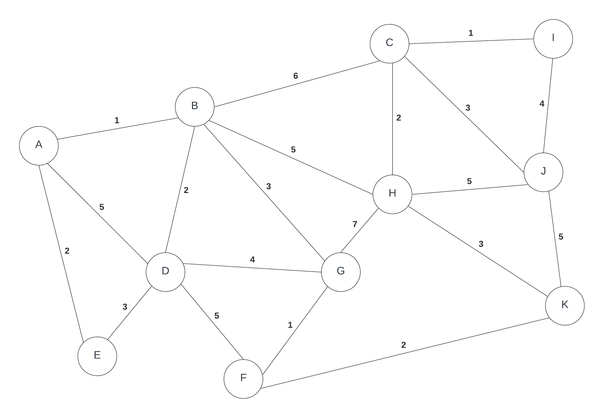

# Lab 4

This assessment contains materials that may be subject to copyright and other intellectual property rights. 

Modification, distribution, or reposting of this document is strictly prohibited. Learners found reposting this document or its solution anywhere will be subject to the college’s Academic Integrity policy.

## Due:
This lab is due at the end of your scheduled lab:
- section `NAA`: Tuesday, Nov 10 2026, @ 15:15
- section `NBB`: Friday, Nov 13 2026, @ 11:35

## Objectives:

In this lab you will work with graph algorithms. Use the following graph for all algorithms.

### In person

- Find one or two partners (groups of 3 or 4)
- On the sheet of paper given write all members of your team. You may need more than one sheet, please make sure your every member of your team has their name on every piece of paper.
- During the process, every member of the group takes turns going through the various algorithm.  During their turn, the group member must continue the algorithm and explain verbally to their teammates why they are doing what they are doing.
  - Take turns to choose the next edge to add by applying Kruskal's algorithm to finding the MST and choose the edge that you are adding.
  - Repeat with Prim's algorithm starting from node A
  - Apply Dijkstra's algorithm to find shortest path to all nodes from A.
    - Create a table like that shown here: https://seneca-ictoer.github.io/data-structures-and-algorithms/G-Graphs/dijkstra but based on the graph for this lab.  Each person takes turn adding the next node.

## Submitting your lab

In order to get a mark for this lab, you must submit:

* the lab sheet that is given to you at start of the lab

## Lab Rubric:

| Criteria       | Poor - 0 mark                                                      | Fair - 1 marks                                                                                       | Good - 2 marks                                                                                 |
| -------------- | ------------------------------------------------------------------ | ---------------------------------------------------------------------------------------------------- | ---------------------------------------------------------------------------------------------- |
| Lab Completion | Arrived in class to do lab more than 30 min late or did not attend | Arrived in class to do lab more than 10 min late but less than 30 min late and/or missing discussion | Arrived in class within the first 10 min of class and submitted work has a thorough discussion |
